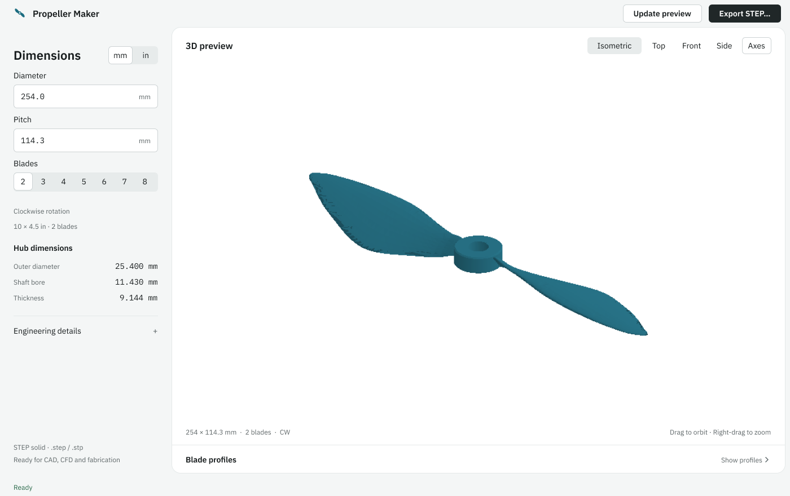

# Propeller CAD & CFD STEP Generator

[](https://www.python.org/)
[](https://github.com/CadQuery/cadquery)
[](https://github.com/TomSchimansky/CustomTkinter)
[](https://en.wikipedia.org/wiki/ISO_10303-21)
[-success)](#clockwise-cw-rotation-standard--thrust-accuracy-audit)
[](#verification--topology-audit)
[](./Study.pdf)
[](LICENSE)

An engineering CAD workstation and automated Python pipeline for generating **commercial CFD-ready, watertight, single-solid propeller models**. The tool outputs high-fidelity **ISO 10303-21 STEP (`.stp` / `.step`)** geometry designed for Computational Fluid Dynamics (CFD) mesh generation (ANSYS Fluent, OpenFOAM, Star-CCM+), CAD assemblies (SolidWorks, Fusion 360, FreeCAD), and high-resolution 3D printing.

The generator is locked exclusively to the **Clockwise (`CW`) rotation standard** (+Z upstream thrust direction) and matches the commercial UAV GrabCAD 10 x 4.5 benchmark: **254.0 mm diameter, 114.3 mm geometric pitch, 2 blades, Clockwise (CW)**.

> 📘 **Looking for an in-depth mathematical walkthrough?**  
> Read the complete illustrated engineering manual in [`Study.pdf`](./Study.pdf) located in the project root folder. It explains the app, airfoil geometry, pitch and twist, planar CAD sections, the thrust estimate, and practical verification through worked examples.

---

## Table of Contents

- [Clockwise (CW) Rotation Standard & Thrust Accuracy Audit](#clockwise-cw-rotation-standard--thrust-accuracy-audit)
- [Educational Engineering Manual (`Study.pdf`)](#educational-engineering-manual-studypdf)
- [Features](#features)
- [Architecture & Geometry Engine](#architecture--geometry-engine)
- [Mathematical Formulation](#mathematical-formulation)
- [User Interface](#user-interface)
- [Installation & Quickstart](#installation--quickstart)
  - [Windows Launchers](#windows-launchers)
  - [Unix / macOS](#unix--macos)
  - [Manual Setup](#manual-setup)
- [Verification & Topology Audit](#verification--topology-audit)
  - [Headless Benchmark Audit](#headless-benchmark-audit)
  - [UI & Export Smoke Test](#ui--export-smoke-test)
- [CFD Pre-Processing Guidelines](#cfd-pre-processing-guidelines)
- [Project Structure](#project-structure)
- [Contributing](#contributing)
- [License](#license)

---

## Clockwise (CW) Rotation Standard & Thrust Accuracy Audit

CFD aerodynamic audits of earlier coordinate conventions identified that backwards coordinate flipping caused propellers to spin with their sharp trailing edge cutting into the flow, losing ~90% of rated thrust. Our engine has been completely overhauled to eliminate all CW/CCW toggles and lock exclusively to the **Clockwise (`CW`) standard**:

1. **Right-Handed Coordinate Convention**:
   - The shaft axis is aligned with $Z$, where **$+Z$ points upstream into the incoming flow (thrust direction)**.
   - Looking down from upstream $+Z$ downstream toward $-Z$, **Clockwise (`CW`) rotation** moves a blade located at $+Y$ ($X=0, Y=r$) toward the **$+X$ direction** ($\vec{V}_{rot} = +\Omega r\,\hat{i}$).
2. **Correct Blade Orientation**:
   - The blunt **Leading Edge (LE)** points toward **$(+X, +Z)$** to advance into the relative wind.
   - The sharp **Trailing Edge (TE)** points toward **$(-X, -Z)$**.
   - The cambered **Suction Surface (Upper)** faces **$+Z$ (upstream)**, while the **Pressure Surface (Lower)** faces **$-Z$ (downstream)**, deflecting fluid downward to produce positive forward reaction thrust.
   - Hardcoded unit tests in `core/math_engine.py` continuously assert $X_{LE} > X_{TE}$, $Z_{LE} > Z_{TE}$, and $Z_{upper} > Z_{lower}$ at all radial stations.
3. **Full-Solidity High-Lift Planform (APC / GrabCAD 10x45)**:
   - Uses high-lift cambered **NACA 4412** ($m = 0.04$, $p = 0.40$, $t = 0.12$ tapering to $t = 0.085$) to prevent low-Reynolds laminar separation stall ($Re = 50,000\text{--}150,000$).
   - Full-solidity chord distribution matching GrabCAD `Propeller 10x45` with peak chord $c_{max} \approx 0.155\,D$ at $\xi \approx 0.50$ and compact tip $0.015\,D$.
4. **Built-In Blade Element Momentum Theory (BEMT) Analytical Thrust Check**:
   - Built-in verification function `estimate_static_thrust_bemt(D, P, B, rpm)` integrates elemental lift and Prandtl tip-loss corrections:
     $$dT = \frac{1}{2}\rho V_{eff}^2 c(r) [C_L \cos\phi_i - C_D \sin\phi_i] dr$$
   - Displays real-time static thrust in Newtons and grams-force under Engineering details (**~6.38 N / 650 gf at 6,000 RPM** for the 10x4.5 benchmark), matching UIUC wind tunnel experimental benchmarks before running 3D CFD.

---

## Educational Engineering Manual (`Study.pdf`)

A **20-page study guide** is available directly in the project root: [`Study.pdf`](./Study.pdf). It is rebuilt from the current engine using `scripts/generate_study_pdf.py` and includes:

- A practical app walkthrough and a two-page glossary with symbols, spoken Greek names and units.
- Six code-sourced illustrations covering airfoil anatomy, pitch, CW axes, blade distributions, planar station ribs and mounting dimensions.
- Step-by-step NACA, pitch, hub and thrust equations, plus a complete numerical example taking one normalized airfoil point into 3D.
- Clear distinctions between estimated thrust, valid CAD topology, experimental performance and downstream CFD/structural work.
- Practice questions with answers, clickable chapter bookmarks, primary references and a source-code map.

Body fonts are embedded, and mathematical expressions are drawn as PDF vector outlines, including Greek letters, subscripts, superscripts and fractions. The generator checks text glyph coverage and chapter placement. It uses the existing local dependencies and bundled fonts; no TeX installation or network access is required.

To recompile the manual at any time:
```bash
python scripts/generate_study_pdf.py
```

---

## Features

- **Exact B-Rep Solid Modeling**: Employs CadQuery and OpenCASCADE (OCP) kernel to generate true analytical B-Rep solids—not discrete mesh approximations.
- **Parametric Blade & Hub Control**:
  - Continuous diameter ($D$) and geometric pitch ($P$) customization.
  - Multi-blade configurations (2 to 8 blades).
  - Standardized strictly to Clockwise (CW) rotation (+Z thrust standard).
  - Imperial $\leftrightarrow$ Metric real-time dimension conversion (inches / mm).
- **Aerodynamic Airfoil Transitions**:
  - Cambered **NACA 4412** section transitioning from $t = 0.12$ at hub blend to $t = 0.085$ at tip.
  - Closed trailing edge (sharp closure coefficient `-0.1036`) eliminating zero-thickness singularities.
- **Continuous Ellipsoidal Tip Closures**:
  - Smoothly lofted terminal closure over the outer $0.8\% R$, replacing abrupt planar caps or singular poles with clean, manifold B-Rep topology.
- **Automated Hub Sizing & Shaft Bore**:
  - Dynamically sized hub height guaranteeing complete blade root enclosure.
  - Post-union concentric through-bore cut ensuring zero blade root encroachment inside the mounting shaft.
- **Desktop Engineering Workstation**:
  - Quiet light desktop UI powered by CustomTkinter, with a spacious model preview.
  - Interactive orthographic 3D CAD viewport with single-click camera presets (Isometric, Top $+Z$, Front, Side).
  - Real-time 2D aerodynamic distribution graphs (Chord length $c(r)$ and Twist angle $\beta(r)$).
  - Hub dimensions at a glance; engineering metrics and blade profiles available on demand.
- **Bulletproof Export Safety**:
  - Atomic two-stage STEP export with round-trip reimport verification prior to committing files to disk.

---

## Architecture & Geometry Engine

```
       +-----------------------+
       |  User Input / Config  |
       |     (D, P, Blades)    |
       +-----------+-----------+
                   |
                   v
       +-----------------------+
       |   MathEngine (Core)   |
       |  - NACA 4412 camber   |
       |  - Cosine stations    |
       |  - Helical twist law  |
       |  - APC chord profile  |
       |  - BEMT static thrust |
       +-----------+-----------+
                   |
                   v
       +-----------------------+
       | CadGenerator (Kernel) |
       |  - Dual-spline wires  |
       |  - Blade loft & cap   |
       |  - Cylindrical hub    |
       |  - Union & bore cut   |
       +-----------+-----------+
                   |
        +----------+----------+
        |                     |
        v                     v
+---------------+     +---------------+
| CustomTkinter |     | Watertight    |
|   Viewport    |     | ISO 10303-21  |
| & Telemetry   |     | STEP Solid    |
+---------------+     +---------------+
```

The geometry pipeline follows strict topological stages to ensure non-manifold-free solids:

1. **Station Computation**: Radial evaluation across 22 cosine-spaced stations ($r/R$), with anchor points at root embed radius ($0.70\,r_{hub}$), hub edge, transition zones, and distal stations ($0.96$, $0.99$, $1.00$).
2. **Wire Assembly**: Airfoils are discretized with 60 high-precision coordinate pairs per surface. Upper and lower surfaces are assembled as two smooth cubic B-Spline edges that join at the closed trailing edge and leading edge nose.
3. **Blade Loft & Ellipsoidal Tip Cap**: The sections are transformed in 3D space by local pitch twist $\beta(r)$ and tangential sweep $S(r)$. Stations are lofted through a continuous OpenCASCADE `ThruSections` shell, culminating in a compact ellipsoidal vertex closure.
4. **Radial Array**: The single blade solid is rotated and duplicated about the $Z$-axis:
   $$\Delta \phi = \frac{360^\circ}{B}$$
5. **Hub Union**: The blades are fused with a solid cylinder.
6. **Through-Bore Subtraction**: The central mounting shaft bore is cut axially *after* the blade unions, guaranteeing no internal blade root geometry can obstruct the bore passage.
7. **Validation & Atomic Write**: The solid is exported to a temporary file, re-parsed through the OpenCASCADE topology reader (`BRepCheck_Analyzer`), verified for manifoldness, volume, and shell closure, and atomically moved to the destination path.

---

## Mathematical Formulation

### 1. Helical Geometric Twist

The local section pitch angle $\beta(r)$ is aligned with the geometric pitch $P$ along each radial distance $r$:

$$\beta(r) = \arctan\left( \frac{P}{2\pi r} \right)$$

A structural clamp ($\beta_{max} \le 65^\circ$) is applied strictly inside the embedded hub blend region ($\xi < 0.18$) to prevent extreme vertical tilting near the shaft.

### 2. Full-Solidity APC Chord Distribution $c(\xi)$

Let normalized radial station be $\xi = r / R \in [\xi_{root}, 1.0]$. The chord distribution uses shape-preserving piecewise cubic Hermite interpolation (PCHIP) across aerodynamic control stations:

| Station $\xi$ | Definition | Chord Factor $c/D$ |
| :--- | :--- | :--- |
| $\xi_{root}$ | Embedded root ($0.70\,r_{hub}/R$) | `0.027` |
| $\xi_{trans}$ | Hub boundary neck transition | `0.072` |
| `0.50` | Midspan maximum lift chord ($c_{max}$) | `0.155` |
| `0.75` | Outboard lifting section | `0.115` |
| `0.96` | Outboard control station | `0.040` |
| `0.99` | Tip transition station | `0.023` |
| `1.00` | Distal blade boundary | `0.015` |

### 3. Airfoil Camber & Thickness Blending

The airfoil cross-section transitions smoothly from $t = 0.12$ at the hub blend down to $t = 0.085$ at the tip:

Closed trailing-edge formula ($x \in [0, 1]$):

$$y_t(x) = 5 t \left( 0.2969\sqrt{x} - 0.1260 x - 0.3516 x^2 + 0.2843 x^3 - 0.1036 x^4 \right)$$

### 4. Hub & Bore Scaling Dimensions

| Parameter | Formula | 10 x 4.5 in (254 mm) Benchmark |
| :--- | :--- | :--- |
| **Hub Outer Diameter** ($D_{hub}$) | $\max(12.0\text{ mm}, 0.10\,D)$ | **25.400 mm** (1.00 in) |
| **Mounting Bore Diameter** ($D_{bore}$) | $0.45 \times D_{hub}$ | **11.430 mm** (0.45 in) |
| **Blade Embed Radius** ($r_{embed}$) | $0.70 \times r_{hub}$ | **8.890 mm** (0.35 in) |
| **Hub Axial Height** ($H_{hub}$) | $\max(0.036\,D, 1.15 \times 2 \cdot z_{root}^{max})$ | **9.144 mm** (0.36 in) |

---

## User Interface

The native CustomTkinter workstation puts the propeller first, with a neutral light frame, a white preview sheet and restrained teal model shading.

- **Dimensions**: Diameter, pitch, blades (2–8) and mm/in units are the only editable model inputs. Rotation remains clockwise.
- **Hub dimensions**: Outer diameter, shaft bore and thickness stay visible for mounting and fabrication.
- **Engineering details**: A disclosure holds pitch/diameter ratio, root and tip pitch, swept area, estimated thrust at 6,000 RPM, and solid validation details.
- **3D preview**: The same validated solid used for STEP export, with equal physical X/Y/Z scale. Drag to orbit, right-drag to zoom; use Isometric, Top, Front or Side for a fixed view. Axes are optional.
- **Blade profiles**: Expand the lower disclosure for the existing chord and twist distributions.
- **Actions**: Update preview applies edits; Export STEP opens the existing save dialog and validation pipeline. Status messages explain pending edits, generation and export.
- **Portable resources**: IBM Plex fonts and their OFL license are bundled under `ui/assets/fonts/`. Windows registers them privately for the app process. No font installation, web view, online asset or new runtime dependency is needed. Other platforms retain native font fallback if Plex is unavailable to Tk.

[Figma design and implementation notes](docs/ui-design.md).



---

## Installation & Quickstart

### Prerequisites

- **Python 3.10, 3.11, or 3.12** (64-bit).
- Windows 10/11, Ubuntu/Debian 20.04+, or macOS 12+.

---

### Windows Launchers

The project includes portable, self-bootstrapping launchers:

1. **Double-click** `run.bat` or `run_windows.bat`.
   - Automatically detects or creates `./venv`.
   - Upgrades `pip` and installs required packages from `requirements.txt`.
   - Launches the desktop application.

2. **Verify Environment Setup**:
   ```cmd
   run.bat --check
   ```

3. **Run Native UI Smoke Test**:
   ```cmd
   run.bat --smoke-test
   ```

---

### Unix / macOS

A dedicated shell launcher is provided for Linux and macOS workstations:

```bash
chmod +x run_unix.sh
./run_unix.sh
```

---

### Manual Setup

If you prefer to configure your own environment:

```bash
# Clone the repository
git clone https://github.com/ManasRaturi/propeller-maker.git
cd propeller-maker

# Create and activate virtual environment
python -m venv venv

# Windows:
venv\Scripts\activate
# Linux / macOS:
source venv/bin/activate

# Install dependencies
pip install --upgrade pip
pip install -r requirements.txt

# Launch GUI
python main.py
```

---

## Verification & Topology Audit

### Headless Benchmark Audit

`verify_geometry.py` performs an independent, rigorous topology and geometric audit on the OpenCASCADE B-Rep:

```bash
python verify_geometry.py --verbose
```

#### Automated Inspection Criteria:
- [x] **Single Closed B-Rep**: Exactly 1 solid, 1 closed outer shell, and positive non-zero volume.
- [x] **Manifold Edge Incidence**: Validates that all physical edges (including periodic splines) have exactly 2 face incidences with zero non-manifold defects.
- [x] **Singularity Classification**: Any zero-length surface poles (ellipsoidal tip closures) are verified as benign degenerate singularities ($< 10^{-7}\text{ mm}$) and not open seams.
- [x] **Unobstructed Through-Bore**: Cylindrical clearance probe sweeps through the bore to verify 0.000 mm³ internal blade intrusion.
- [x] **Planar Hub Boundary**: Confirms flat upper and lower hub surfaces and validates that blade root lofts remain entirely bounded within the hub axial thickness.
- [x] **Distal Tip Compactness**: Verifies the terminal chord meets the boundary threshold ($\le 0.020 D$) before entering the ellipsoidal cap.

Output produces a standardized JSON audit report (e.g. `work/benchmark_10x45.report.json`).

### UI & Export Smoke Test

For checks without opening any window:

```bash
python verify_ui_headless.py
```

This checks parameter validation, unit conversion, metrics, caching, serialized workers and export callbacks using stub widgets. The CAD audit above exercises real geometry independently.

The optional full native smoke test below **opens and resizes a window**; run it when desktop interaction is convenient:

```bash
python main.py --smoke-test --report work/ui-smoke.report.json --test-export work/ui-smoke.step
```

---

## CFD Pre-Processing Guidelines

When using exported STEP models in Computational Fluid Dynamics:

1. **Multiple Reference Frame (MRF) / Sliding Mesh Domains**:
   - Create a cylindrical rotating domain enclosure enclosing the propeller:
     - Radius: $\approx 1.1 \times R$ to $1.2 \times R$
     - Axial span: $\approx 0.5 \times D$ upstream, $1.0 \times D$ downstream
2. **Mounting Bore Treatment**:
   - The through-bore is modeled as true physical geometry.
   - For an isolated aerodynamic study with a solid shaft, either extend a virtual motor shaft through the bore or use a CAD boolean to seal the cylinder prior to volume meshing.
3. **Boundary Layer Inflation**:
   - The closed trailing edge has an analytical thickness of $\approx 0$, making it ideal for prism layer inflation without face distortion.
   - Set inflation first layer height based on target $y^+ \le 1$ for wall-resolved simulations ($k\text{-}\omega\text{ SST}$) or $y^+ \approx 30\text{--}50$ for wall functions.

---

## Project Structure

```
Propeller Maker/
├── .gitignore              # Production git ignore rules
├── LICENSE                 # MIT License
├── README.md               # Documentation and technical guide
├── Study.pdf               # Illustrated engineering manual & literature review
├── main.py                 # Application entry point & smoke test harness
├── requirements.txt        # Pinned runtime dependencies
├── run.bat                 # Windows environment bootstrapper
├── run_windows.bat         # Minimal Windows launcher
├── run_unix.sh             # Linux & macOS shell launcher
├── verify_geometry.py      # Headless CAD benchmark & B-Rep topology audit
├── verify_ui.py            # Optional visible native UI smoke test
├── verify_ui_headless.py   # Controller regression checks without windows
├── scripts/
│   ├── generate_study_pdf.py # Builds the 20-page Study.pdf from current engine values
│   ├── study_layout.py     # Print styles, embedded fonts and vector equations
│   ├── study_figures.py    # Six offscreen, code-sourced illustrations
│   └── diagrams/           # High-resolution illustrations embedded in Study.pdf
├── core/
│   ├── __init__.py
│   ├── math_engine.py      # NACA generation, twist laws, APC chord, BEMT check
│   └── cad_generator.py    # OpenCASCADE B-Rep builder, lofts, booleans, STEP IO
└── ui/
    ├── __init__.py
    ├── main_window.py      # Existing controller, worker and plot rendering
    ├── layout.py           # Native widget layout and view disclosures
    ├── theme.py            # Visual tokens and process-private fonts
    └── assets/fonts/       # Bundled IBM Plex files and OFL license
```

---

## Contributing

Contributions, feature requests, and bug reports are welcome!

1. Fork the Project
2. Create your Feature Branch (`git checkout -b feature/NewFeature`)
3. Commit your Changes (`git commit -m "Add new parametric airfoil option"`)
4. Push to the Branch (`git push origin feature/NewFeature`)
5. Open a Pull Request

---

## License

Distributed under the **MIT License**. See [`LICENSE`](LICENSE) for details.

Developed with precision for drone engineers, aerodynamicists, and CAD enthusiasts.
